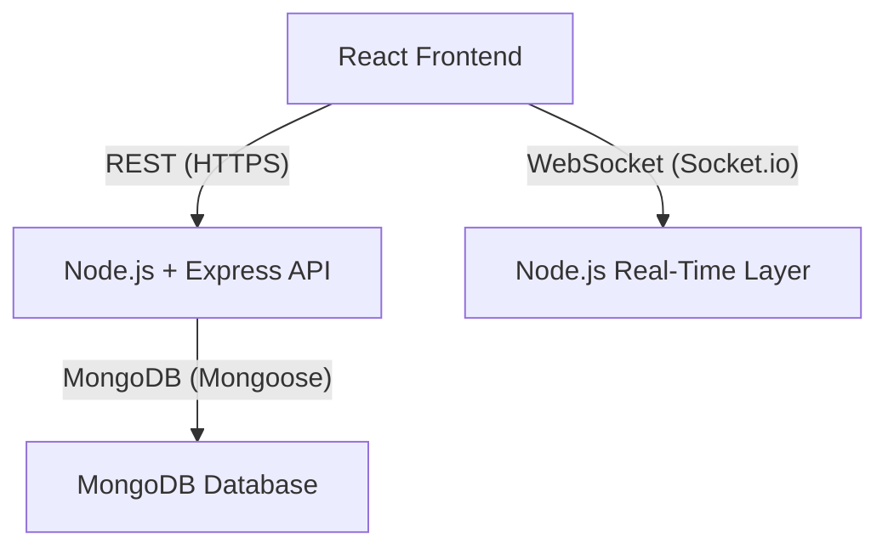

<h1 align="center">Real-Time MERN Chat Application with RBAC</h1>

<b>Secure, scalable, and production-grade real-time chat system with role-based access control</b>

---

## Overview

This project is a portfolio-grade, real-time chat application built on the MERN stack (MongoDB, Express, React, Node.js) with robust WebSocket messaging and comprehensive role-based access control (RBAC). It is designed to demonstrate advanced system design, security, and scalability principles beyond basic chat functionality.

---

## Why This Project?

Unlike typical chat demos, this project addresses real-world engineering challenges:

- **Securing WebSocket connections**
- **Enforcing RBAC in both REST APIs and real-time events**
- **Designing scalable MongoDB schemas for high-volume messaging**
- **Planning for horizontal scalability from the outset**

---

## Target Audience

- Engineers building collaborative or communication platforms
- Teams requiring role-aware, real-time systems
- Recruiters evaluating backend, security, and system design skills

---

## Core Features

### Chat Functionality

- One-to-one (direct) and group messaging
- Real-time delivery via WebSockets (Socket.io)
- Persistent message storage in MongoDB
- Online/offline presence and typing indicators

### Role-Based Access Control (RBAC)

- Explicit roles and permissions (user, moderator, admin)
- Backend-enforced authorization for all REST and WebSocket events
- Consistent RBAC enforcement across all layers

### Admin & Moderation

- Admins: manage users, assign roles
- Moderators: manage group behavior, delete messages
- All permissions enforced server-side (never trusted from UI)

---

## High-Level Architecture

**Principles:**

- REST handles stateful operations
- WebSockets handle real-time events
- Server is the single source of truth
- Frontend gates UX, backend enforces security

---

## Technology Stack

**Frontend:**

- React (Next.js)
- Socket.io client
- Tailwind CSS
- Role-aware UI rendering

**Backend:**

- Node.js, Express
- Socket.io
- JWT authentication
- RBAC middleware

**Database:**

- MongoDB (Mongoose ODM)
- Indexed collections for scalability

---

## Authentication & Authorization

**Authentication:**

- JWT-based authentication for both REST and WebSocket connections

**Authorization (RBAC):**

- Permissions-based access control
- Roles are collections of permissions
- Authorization enforced per REST route and WebSocket event
- Frontend role checks are for UX only; all security is enforced on the backend

---

## Data Model Overview

**User:**

- Identity, authentication data, role assignment, account status

**Role:**

- Named role (user, moderator, admin), explicit permission list

**Conversation:**

- Direct/group type, participant references, metadata (last message timestamp)

**Message:**

- Sender, conversation reference, content, metadata, soft deletion

**Indexes:**

- Conversation membership, message timestamps, high-frequency query paths

---

## Real-Time & REST Responsibilities

**WebSocket:**

- Message delivery, typing indicators, presence updates

**REST:**

- Authentication, message history, user/role management, admin actions

_Separation of concerns improves maintainability and scalability._

---

## Security Considerations

Security is a core feature, not an afterthought:

- JWT validation on every socket connection
- Permission checks on all socket events
- Conversation membership validation
- Input sanitization (XSS prevention)
- No trust in client-sent role/permission data

---

## Scalability Strategy

**Current:**

- Single Node.js instance, in-memory socket state, optimized MongoDB queries

**Planned:**

- Redis-backed Socket.io adapter
- Horizontal Node.js scaling
- Stateless REST APIs
- Message pagination & archiving

_Architecture is designed for seamless scaling with minimal refactoring._

---

## Design Trade-Offs

- End-to-end encryption is out of scope (focus: RBAC correctness)
- Mobile apps deferred for system design depth
- Notifications excluded to focus on real-time architecture

_These choices prioritize architectural clarity and security over feature count._

---

## What This Project Demonstrates

- Real-time system design
- Secure WebSocket authentication
- RBAC beyond CRUD APIs
- Scalable MongoDB data modeling
- Production-oriented, security-first thinking

---

## Future Enhancements

- Redis-based socket scaling
- Read receipts & message reactions
- Audit logs for admin actions
- Observability (logging & metrics)

---

## Final Note

This project is a systems design exercise implemented in MERN, not just a chat app. Reviewers should focus on:

- Architecture decisions
- Security model
- RBAC enforcement strategy
- Scalability planning
