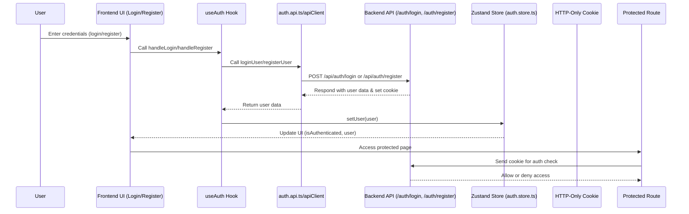

# Global State and Authentication in ChatApp

## Current Implementation

### Global State Management

- **Client/UI State:**
  - Managed using [Zustand](https://zustand-demo.pmnd.rs/).
  - Each feature (e.g., `auth`, `chat`) has its own store in `features/<feature>/store`.
  - Used for UI state, modals, and any data that only lives in the browser.
- **Server State:**
  - Managed using [React Query](https://tanstack.com/query/latest).
  - Data fetched from the backend (e.g., messages, user lists) is handled via React Query hooks, typically in `features/<feature>/api` and composed in components.
  - The `Providers.tsx` file in `providers/` sets up the React Query client globally and now exports a singleton QueryClient instance for use in synchronization logic.
- **Guiding Principle:**
  - If state comes from the backend → **React Query**.
  - If state lives in the browser → **Zustand**.

### Authentication

- **Auth State:**
  - Managed in `features/auth/store/auth.store.ts` (Zustand store).
  - Auth logic (login, register, logout) is in `features/auth/api/auth.api.ts` and related components/hooks.
  - AuthProvider in `providers/AuthProvider.tsx` handles hydration and syncs auth state between backend and frontend.
- **Routing:**
  - Next.js route groups: `(protected)` for authenticated routes, `(public)` for guest routes.
  - Middleware in `app/middleware.ts` can enforce route protection.
- **Token Handling:**
  - Uses HTTP-only cookies for session tokens (secure, SSR-friendly).
  - Auth state is rehydrated on page load for consistency.

---

## 🔄 Centralized Auth Synchronization (New)

To prevent bugs from duplicated auth state, the app now uses a **centralized synchronization mechanism**:

- **Shared QueryClient Singleton:**
  - The `Providers.tsx` file exports a singleton QueryClient instance via `getQueryClient()`.
  - This ensures all cache operations (invalidate, clear) affect the same React Query cache used by the app.

- **Auth Event Handler (`lib/auth/auth-sync.ts`):**
  - Handles all major auth events (`LOGIN`, `LOGOUT`, `SESSION_EXPIRED`).
  - On login: updates Zustand store and invalidates all React Query queries (triggers refetch of protected data).
  - On logout/session expired: clears Zustand store and React Query cache, ensuring no stale or protected data remains in memory.

- **Global 401 Handling:**
  - The Axios instance (`lib/api/apiClient.ts`) has a response interceptor that triggers the auth event handler on 401 errors, ensuring the UI reacts to expired tokens or unauthorized access.

- **Hydration:**
  - `AuthProvider.tsx` hydrates Zustand and React Query state from the backend/cookie on both SSR and CSR, keeping state consistent across reloads and navigation.

---

## Authentication Flow Diagram

```mermaid
graph TD
    A[App Loads] --> B{Check Auth State}
    B -- SSR/Initial Load --> C[AuthProvider Hydrates State]
    C --> D{Is Authenticated?}
    D -- No --> E[Show Public Routes (Login/Register)]
    D -- Yes --> F[Show Protected Routes (Chat, etc.)]
    F --> G[Fetch User Data via React Query]
    G --> H[Sync Zustand Store]
    E --> I[User Submits Login/Register]
    I --> J[Call Auth API]
    J -- Success --> K[Set Auth Cookie/Token]
    K --> L[Hydrate Zustand Store]
    L --> F
    J -- Failure --> M[Show Error]
    F --> N[User Interacts (Send Message, etc.)]
    N --> O[API Calls with Auth Token]
    O --> P[React Query Updates State]
    P --> Q[Zustand/UI Updates]
```

---

## Areas for Improvement

1. **Centralized Auth Sync:**
   - ✅ Now handled via a shared QueryClient and event handler.
   - All state (Zustand, React Query, cookies) is kept in sync on login, logout, and session expiration.
2. **SSR/CSR Consistency:**
   - Hydration logic ensures state is consistent on both server and client.
3. **Error Handling:**
   - 401 errors trigger a full logout and cache clear.
4. **Token Refresh:**
   - (Optional) Can be added for silent refresh.
5. **Role-Based Access Control (RBAC):**
   - (No change)
6. **Testing:**
   - (No change)
7. **Security:**
   - (No change)
8. **Documentation:**
   - ✅ This doc now reflects the improved architecture.

---

## Summary Table

| Aspect           | Current Approach            | Suggested Improvement              |
| ---------------- | --------------------------- | ---------------------------------- |
| State Management | Zustand + React Query       | Centralize sync, improve hydration |
| Auth State       | Zustand store, AuthProvider | SSR/CSR sync, error handling       |
| Token Handling   | Cookies, rehydration        | Silent refresh, secure cookies     |
| RBAC             | Scattered/feature-based     | Centralize, enforce everywhere     |
| Error Handling   | Varies                      | Standardize, user-friendly         |
| Testing          | Partial                     | More coverage                      |
| Documentation    | Good, but evolving          | Keep updated                       |

---

**In summary:**

- The architecture is solid and modern, using best practices for state and auth.
- Focus next on improving consistency, security, and developer experience for a production-grade app.

---

# 🔐 User Authentication Flow: Visual & File Responsibility Guide

This section provides a **visual and descriptive breakdown** of the user authentication flow, from frontend to backend, including which files are responsible for each step.

---

## 1. High-Level Flow Diagram



---

## 2. File-by-File Responsibilities

### **Frontend (Client)**

- **`features/auth/components/LoginForm.tsx` / `RegisterForm.tsx`**
  - UI forms for user input.
  - Calls `useAuth` hook on submit.

- **`features/auth/hooks/use-auth.ts`**
  - Main logic for login, register, and logout.
  - Handles loading, error, and success states.
  - Calls API functions (`loginUser`, `registerUser`).
  - Updates Zustand store with user info.

- **`features/auth/api/auth.api.ts`**
  - Defines `loginUser`, `registerUser` functions.
  - Uses `apiClient` to make HTTP requests to backend.

- **`lib/api/apiClient.ts`**
  - Axios instance with base URL and credentials.
  - Handles sending cookies with requests.

- **`features/auth/store/auth.store.ts`**
  - Zustand store for auth state (`user`, `isAuthenticated`).
  - Provides `setUser`, `logout` actions.

- **`providers/AuthProvider.tsx`**
  - Hydrates auth state on app load (e.g., checks if user is already logged in via cookie).

- **`app/(protected)/`**
  - Protected routes/pages.
  - Only accessible if authenticated.

---

### **Backend (Server)**

- **`routes/auth.route.js`** (or `authRoutes.js`)
  - Defines `/api/auth/login`, `/api/auth/register`, `/api/auth/logout` endpoints.

- **`controllers/auth.controller.js`**
  - Handles login/register logic.
  - Verifies credentials, creates user, returns user data.

- **`middleware/authMiddleware.js`**
  - `protect` middleware checks for valid JWT in HTTP-only cookie.
  - Attaches `req.userId` if authenticated.

- **`models/User.js`**
  - User schema/model for MongoDB.

- **`routes/userRoutes.js`**
  - Handles `/profile` and other user-related endpoints.
  - Uses `protect` middleware for protected routes.

---

### **Authentication State**

- **Session is maintained via HTTP-only cookie (JWT) set by backend.**
- **Frontend checks auth state via Zustand store and/or by hydrating from backend on load.**
- **Protected routes/pages/components check `isAuthenticated` and redirect if not logged in.**

---

## 3. Example: Login Flow Step-by-Step

1. **User submits login form** (`LoginForm.tsx`)
2. **`useAuth.handleLogin`** is called (`use-auth.ts`)
3. **`loginUser`** sends POST to `/api/auth/login` (`auth.api.ts` → `apiClient.ts`)
4. **Backend validates credentials** (`auth.controller.js`)
5. **Backend sets HTTP-only cookie** and returns user data
6. **Frontend updates Zustand store** with user info (`auth.store.ts`)
7. **UI updates** to reflect authenticated state
8. **Protected pages** now accessible

---

## 4. Visual Directory Map

```text
client/
├── features/
│   └── auth/
│       ├── api/           # auth.api.ts (API calls)
│       ├── components/    # LoginForm, RegisterForm
│       ├── hooks/         # use-auth.ts (auth logic)
│       ├── store/         # auth.store.ts (Zustand)
│       └── types.ts
├── lib/
│   └── api/
│       └── apiClient.ts   # Axios instance
├── providers/
│   └── AuthProvider.tsx   # Hydration on load
└── app/
    └── (protected)/       # Protected pages
```

```text
server/
├── routes/
│   ├── auth.route.js      # Auth endpoints
│   └── userRoutes.js      # User profile, etc.
├── controllers/
│   └── auth.controller.js # Auth logic
├── middleware/
│   └── authMiddleware.js  # protect middleware
└── models/
    └── User.js            # User schema
```

---

## 5. Summary Table

| Layer      | File(s)                           | Responsibility                               |
| ---------- | --------------------------------- | -------------------------------------------- |
| UI         | LoginForm.tsx, RegisterForm.tsx   | User input, calls useAuth                    |
| Logic      | use-auth.ts                       | Handles login/register/logout, updates store |
| API        | auth.api.ts, apiClient.ts         | HTTP requests to backend                     |
| State      | auth.store.ts                     | Zustand store for auth state                 |
| Provider   | AuthProvider.tsx                  | Hydrates auth state on app load              |
| Backend    | auth.route.js, auth.controller.js | Auth endpoints and logic                     |
| Middleware | authMiddleware.js                 | Protects routes, checks JWT                  |
| Model      | User.js                           | User schema                                  |
| Protected  | app/(protected)/                  | Auth-only pages                              |

---
